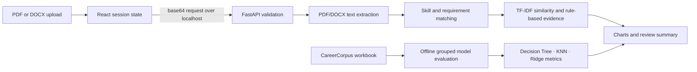

# EquiHire

A privacy-conscious resume analysis portfolio project built with React, Vite, FastAPI, and scikit-learn. EquiHire extracts selectable text from PDF/DOCX resumes (with optional local OCR for scanned PDF pages), identifies skill mentions, compares resume text with role criteria, and visualizes evidence coverage. Uploads are processed in memory and never persisted. Raw resume text and excerpts are not returned; the API returns parsed profile fields and aggregate skill/requirement signals for the same browser session.

### What it demonstrates

- Resume document processing, validation, and extraction quality reporting.
- Explainable skill and requirement matching with TF-IDF cosine similarity.
- Offline regression experiments: Decision Tree, KNN, and Ridge, grouped cross-validation, per-domain errors, and resume-group bootstrap intervals.
- Accessible, responsive React dashboard with drag-and-drop, keyboard states, API health status, charts, and human-review guidance.
- Resume-based career exploration suggestions with detected skill sources, reviewer correction toggles, synthetic demo data, and next-skill ideas.
- Automated parser tests and GitHub Actions CI for backend tests and frontend builds.

### Architecture



The offline CareerCorpus models estimate agreement with expert relevance ratings for six broad categories. They do not predict hiring outcomes or skill proficiency and do not train on uploaded resumes.
## Fresh-clone setup

From the project root, install the API and UI dependencies:

```bash
python3 -m venv .venv
source .venv/bin/activate
python -m pip install -r requirements.txt
npm ci
```

For the backend test suite, also install `requirements-dev.txt`. Scanned-PDF OCR is optional and requires the Tesseract executable to be installed separately. CareerCorpus is a separate, locally supplied workbook; see [fresh-clone dataset setup](docs/DATA_CARD.md#local-setup). The current workbook reader uses `openpyxl`, so Pandas is not required.

For a browser-to-API walkthrough and synthetic demo, follow the [manual end-to-end check](docs/MANUAL_E2E.md). A fictional sample job description is provided in [docs/demo/data-analyst-role.txt](docs/demo/data-analyst-role.txt). See the [model card](docs/MODEL_CARD.md) and [data card](docs/DATA_CARD.md) for intended use, benchmark scope, attribution, failure cases, and limitations.

## Start the API

```bash
source .venv/bin/activate
uvicorn backend.main:app --reload --port 8000
```

The API documentation is at <http://localhost:8000/docs> while the server is running. For a separately hosted frontend, set `EQUIHIRE_ALLOWED_ORIGINS` to a comma-separated list of allowed frontend origins.

## Start the UI

In a second terminal:

```bash
npm run dev
```

Vite serves the app at <http://localhost:5173>. The UI calls `http://localhost:8000/analyze`; set `VITE_API_URL` if the API runs elsewhere.

## Current analysis limits

The analysis uses PDF/DOCX text extraction and a curated skill vocabulary with phrase matching. TF-IDF similarity provides a text-overlap signal when wording differs; it does not confirm competency. Requirement evidence triage is a transparent text baseline. A separate Decision Tree/KNN/Ridge regression benchmark estimates expert relevance scores only for the six CareerCorpus role categories. Evaluation uses grouped cross-validation, fold metrics, and group-bootstrap confidence intervals. Neither evidence coverage nor the regression estimates measure actual proficiency or predict hiring outcomes. Image-based PDF pages receive best-effort OCR when Tesseract is installed; scanned resumes should still be checked in the preview. Unfamiliar roles need explicit job requirements for evidence coverage. Uploaded resume content is kept in request memory and browser session state only; it is never saved or added to the research dataset.

## ML evaluation workflow

The offline ML benchmark uses CareerCorpus to predict a human-assessed broad resume-to-role relevance score. It compares TF-IDF + Decision Tree, KNN, and Ridge regression with a mean baseline, reporting fold metrics and group-bootstrap confidence intervals. See [ml/DATA_GUIDE.md](ml/DATA_GUIDE.md) for the target, source, attribution, and limitations. Uploaded resumes are still processed in memory and are never added to the training data automatically. The CareerCorpus workbook is kept locally and Git-ignored. Once it is at `data/public/CareerCorpus.xlsx`, run:

```bash
python -m ml.train_evaluate
```

This compares Decision Tree, KNN, and Ridge with grouped cross-validation and group-bootstrap confidence intervals. It writes an aggregate report to ignored `reports/` and refreshes `public/model_metrics.json` for the UI. The workbook is a separate public research dataset; it is not populated from candidate uploads. For supported categories, the API fits the regressors in memory from the local workbook and returns Decision Tree, KNN, and Ridge role-relevance estimates. Requirement-by-requirement evidence matching stays separate. The regression estimates expert relevance ratings only for the dataset's six categories and are not a hiring model.


## Tests and CI

Install development requirements and run the parser suite:

```bash
python -m pip install -r requirements-dev.txt
python -m pytest -q
```

`npm run build` checks the production UI bundle. GitHub Actions runs both checks on pushes and pull requests.
